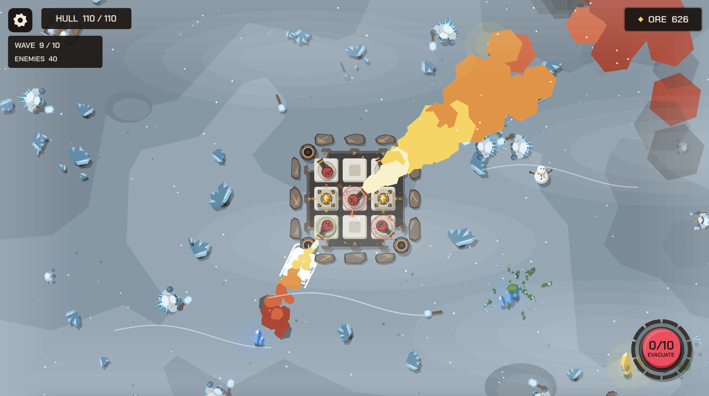
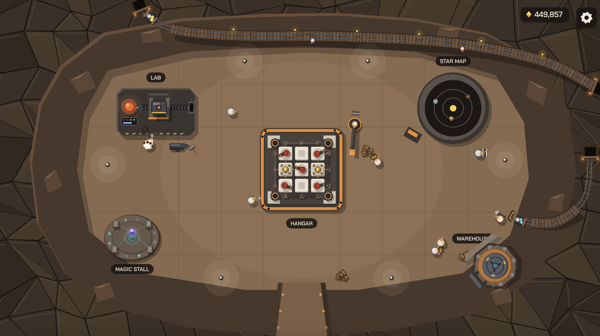
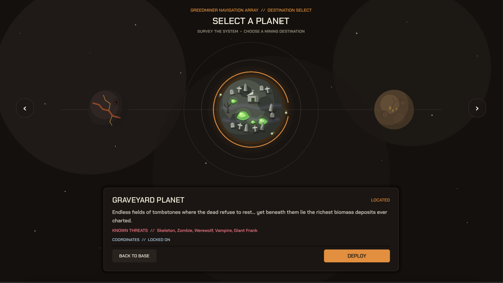

# GreedMiner

**Build your ship. Mine hostile worlds. Get out with your loot.**

GreedMiner is a work-in-progress 2D, top-down mining and tower-defense game built with Godot and GDScript. Assemble a modular spacecraft at your asteroid base, deploy to dangerous planets, and defend your mining operation against waves of enemies. Bring ore home to research upgrades and prepare for the next expedition.


*A mining expedition on Frozen Planet.*

## The gameplay loop

1. **Build at the base.** Configure your ship's 3 × 3 module grid. Balance weapons, mining, power, and defensive modules within your available capacity.
2. **Choose a destination.** Use the star map to explore planets with different environments and enemies. Some destinations require research and resources before you can reach them.
3. **Mine and defend.** Your ship remains in place while its weapons fight approaching enemies. Gather ore during the expedition and respond to mining events as they appear.
4. **Survive or evacuate.** Face enemy waves and powerful bosses, or press the evacuation button repeatedly to leave with the ore you have collected. If your ship is destroyed, the ore from that run is lost.
5. **Upgrade and return.** Spend your recovered ore on research and use unlocked modules, chips, and artifacts to refine your build.

## Explore your base



The base is your home between expeditions. Visit the **Hangar** to change your loadout, the **Laboratory** to research upgrades, and the **Star Map** to choose your next destination. The **Warehouse** and **Magic Stall** support your growing collection as you progress.

## Choose a planet



Explore Rocky, Verdant, Frozen, Volcanic, and Graveyard planets, each with its own setting and threats. Progression unlocks access to more destinations as you develop your ship.

## Features

- **Modular ship building:** customize nine slots with weapons, mining, energy, and defensive modules.
- **Automated defense:** combine weapons such as the machine gun, dwarf cannon, laser, chainsaw, and flamethrower.
- **Mining expeditions:** collect ore and interact with mining events. On Rocky Planet, dispatch a dwarf from a mining module to collect crystals and bring their ore back to the ship.
- **Waves and bosses:** confront planet-specific enemy waves, special encounters, and bosses.
- **Persistent progression:** research upgrades, unlock equipment, and customize builds with chips and unique magic artifacts.
- **Language settings:** English and Simplified Chinese are available from the base settings menu.

## Controls

| Input | Action |
| --- | --- |
| Left click | Select, interact with menus, and operate on-screen prompts. |
| Drag from a mining module to a crystal | Dispatch a dwarf miner on Rocky Planet. |
| Right click a mining module | Recall its active dwarf miner. |
| Space or left click | Respond to the precision mining skill check when its needle is moving. |
| Esc | Open or close settings in the base overview and battle; back out of other base panels. |

Weapons attack automatically; focus on your loadout, mining opportunities, and when to evacuate.

## Run the project

1. Install **Godot 4.7.2 Standard** or a compatible Godot 4 version.
2. Clone this repository and import its `project.godot` file in the Godot Project Manager.
3. Open the project and press **F5** (Run Project). The game starts at the base.

The project uses **GDScript** and the **GL Compatibility** renderer; the .NET edition of Godot is not required. A Web export preset is included in `export_presets.cfg`. To export a browser build, install matching Godot Web export templates and use the **Web** preset in Godot's Export dialog.

## Project structure

```text
Scenes/       Game scenes and UI
Scripts/      Gameplay systems, UI logic, and GDScript
Resources/    Configurations and data-driven game content
Assets/       Fonts and other project assets
Translations/ Localization resources
Tests/        Godot test scenes and scripts
docs/         Project documentation and screenshots
```

## Development status

GreedMiner is under active development. Gameplay balance, content, visuals, and controls may change as the project evolves.
